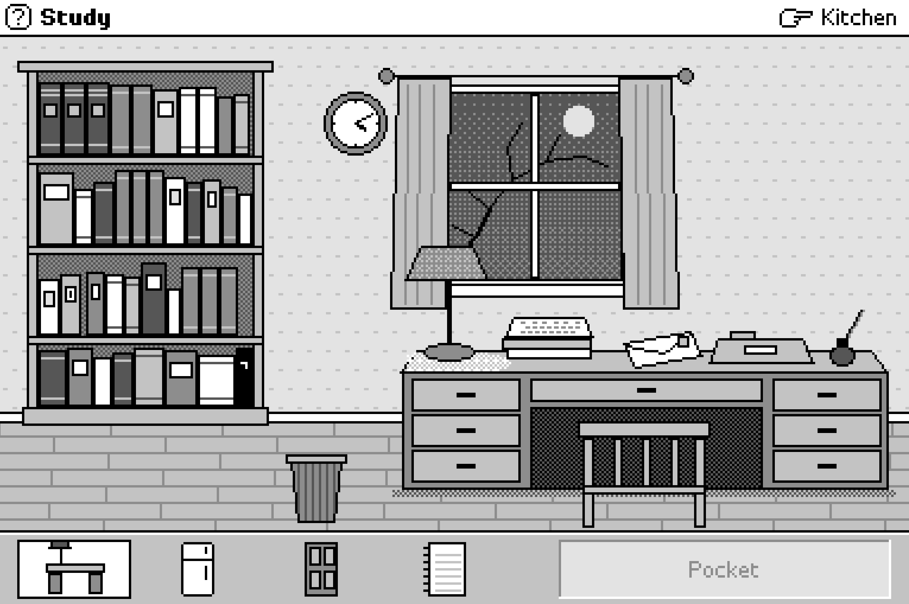

**November 9, 2026.** *A short puzzle game about Kurt Gödel.*

For a long time, I've been fascinated by logician Kurt Gödel and the strange
circumstances of his death. In 1978, his wife Adele was admitted to
hospital for a stroke, and Gödel—used to having her test his
food—died of starvation. I decided to explore this period of his
life in the form of a puzzle game, centering on Gödel-style logic
puzzles with a self-referential flavour. I've tried to be sensitive
but the game does gently allude to how he died.

<figure>
    

	<figcaption>  <i>With apologies to Susan Kare.</i></figcaption>
	

	</figure>

Two other heavy inspirations: Susan Kare's design work for General
Magic's Magic Cap OS, and Miklhail Bulgakov's *The Master and
Margarita*. You'll see if you play.

[Play](https://heptar.ch/antiquine.html)

*Postscript.* I designed the overall shape of the game, but the code
 was written by Claude (Opus 5.5) and puzzles were created collaboratively.
