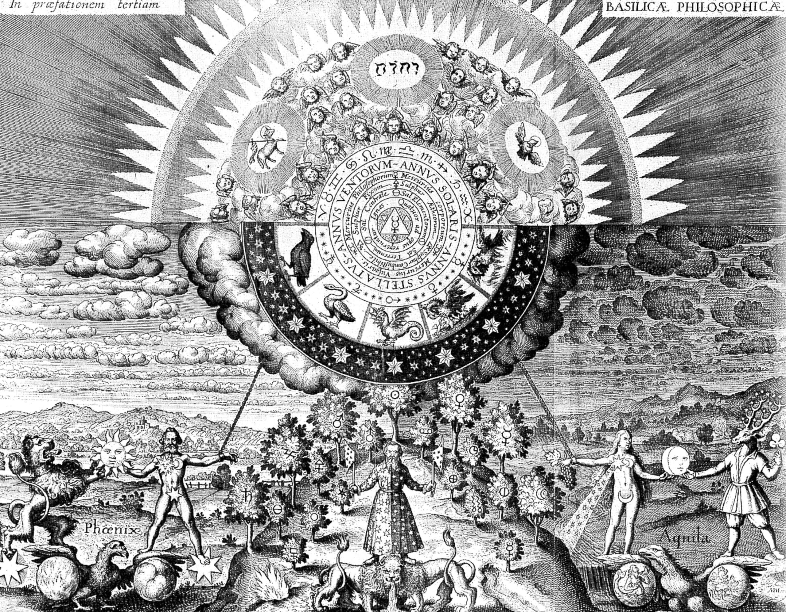
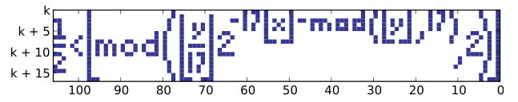

#+ATTR_HTML: :alt tetris image :align center :width 700px :style display:inline;margin:0px;

#+begin_right
/See the sun in the day; watch the stars at night./ (A Zen Forest, 773)
#+end_right

* Introduction
-----
** Roads to wonder 

The universe is huge, ancient, and marvelously strange. But the greatest miracle of all is that
it is knowable. Our knowledge may be fragmentary and often plain wrong; that is the basic
predicament of science. But it makes it no less miraculous that we can unravel the biological
blueprint of a daffodil, land a robot on the red sands of Mars, or hear the faint chirp of black
holes colliding, in the depths of space, a billion years ago. There is awe and beauty and cosmic
providence in this. This book is written from the conviction that awe, beauty, and providence
are almost entirely missing from our curricula. We teach the wrong things, using the wrong
methods, for the wrong reasons. The outcome is, of course, deeply
wrong.

Let me elaborate. If students learn to reproduce known results by rote, they will take both
the methods and the results for granted. Of course gravity obeys an inverse square law! It’s
obvious. But why? What assumptions does this depend on? What else might obey an inverse
square law, and what happens if it doesn’t? They neither know nor care because they are
taught not to. In the same vein, when we assess mastery by trivial variations on known things,
students come to identify mastery with trivial variation. After variation number 173, they will
resent this “mastery” and see it for the sham that it is. No wonder so
many people are proud to be bad at math! Worst of all, students learn to mask their ignorance. There is no
better way to discourage a love of play and a taste for the unknown than by labelling questions
“stupid”, and rewarding those who “fake it till they make it”. Or, more realistically, simply go
on faking.

If formal education kills this sense of awe and beauty with military efficiency,
where can it be found? If you’re lucky, the rigors of graduate school. A better bet is to pick a
volume at random from the popular science section at your local bookstore. Here you will find
the universe described in loving wonder, and the greater portion of that wonder reserved for
the unknown itself. There are no tests, no pointless variations, and best of all, no such thing as
a stupid question. The whole premise of the genre is that the reader doesn’t know! They can
dip in, explore, play around, have fun, and remain a non-expert at the end of day, free to admit
their ignorance and keep asking. If they fake it, the only person they deceive is themselves.
School does not work this way, and when teachers make the same quip about cheating, they
are neglecting the systemic realities—the hoops to jump through, the boxes to tick, all those
perverse incentives to fake it—that they help maintain. The day that cheating is unnecessary,
there will be no cheating.@@html:<label for="sn-1"
       class="margin-toggle sidenote-number">
</label>
<input type="checkbox"
       id="sn-1"
       class="margin-toggle"/>

  AI complicates the situation only marginally; cheating remains a
matter of assessment design and structural incentive.
@@

So, this is not a textbook, nor is it a manual, a manifesto or a monograph. I have no interest
in replacing one rigidity with another. Instead, it is an invitation to ask stupid questions, and
to learn about the universe with a spirit of play and wonder. I take inspiration from hacker
culture, not the digital intruders and electoral trolls that “hacker” suggests to the modern ear,
but an older, nobler tradition growing out of places like MIT, Bell Labs, and the open-source
software movement. In the words of open-source gnuru Richard Stallman:

@@html:

What [hackers] had in common was a love of excellence and programming. They
wanted to make the programs that they used be as good as they could. They also
wanted to make them do neat things. They wanted to be able to do something in
a more exciting way than anyone believed possible and show ‘Look how wonderful
this is. I bet you didn’t believe this could be done.’

@@

Stallman is articulating here a broad ethos of play, excellence, and creativity. Put simply, the
idea is to do cool things in cool ways.
That’s how we can learn and have fun at the same
time, activities no longer at odds, but combined and harmonized to the point they become
indistinguishable. To paraphrase L. P. Jacks, a hacker

@@html:

. . . simply pursues their vision of excellence at whatever they do, leaving others to
decide whether they are working or playing. To them, they are always
doing both.

@@

When Google co-founder Larry Page built a working inkjet printer out of Lego, or MIT
pranksters transformed a campus building into a giant version of Tetris, were they working
or playing? The answer is both; they were hacking, so the distinction
is irrelevant.

#+CAPTION: The Green Building of MIT, transformed into a game of Tetris (2026).
#+ATTR_HTML: :alt tetris image :align center :width 400px :style display:inline;margin:0px;

This philosophy goes well beyond programming. One of the great avatars of hacker spirit is Richard
Feynman, a physicist who won the Nobel Prize for co-inventing quantum electrodynamics,
but had a history of hopping between different areas and doing amazing things wherever he
landed. He gave this advice to an aspiring scientist:

@@html:

Study hard what interests you the most in the most undisciplined, irreverent and
original manner possible.

@@

This is a terrible recipe for conventional academic success, which usually requires studying
hard what interests us not at all, in a disciplined and reverent fashion along well-trodden paths.
But Feynman had no time for convention, and followed his own advice. In his autobiography,
he describes the fruits of his policy of free and creative
exploration:

@@html:

Why did I enjoy [physics]? I used to play with it. I used to do whatever I felt like
doing — it didn’t have to do with whether it was important for the development of
nuclear physics, but whether it was interesting and amusing for me to play with. . .
It was easy to play with these things. It was like uncorking a bottle: Everything
flowed out effortlessly. I almost tried to resist it! There was no importance to what
I was doing, but ultimately there was. The diagrams and the whole business that I
got the Nobel Prize for came from that piddling around with the
wobbling plate.

@@

The plate, here, is one that Feynman saw wobbling oddly when thrown in the Cornell cafeteria.
He sat down, figured out the wobble, and was led, step by associative step, to a Nobel Prize.
Working and playing go together.

** Hack value

Hacker culture is organized around discrete units called hacks. A hack is more than a
record of play, or mere cleverness, or even creative flair. It is play condensed by technical wit,
and like a good joke, has an element of surprise or shortcut. A brilliant example is Tupper’s
self-referential formula. Consider the inequality

$$
\frac{1}{2} < \left\lfloor
\text{mod}\left(\left\lfloor\frac{y}{17}\right\rfloor 2^{-17\lfloor
x\rfloor} - \text{mod}(\lfloor y\rfloor, 17), 2\right) \right\rfloor,
$$

where $\lfloor x\rfloor$ indicates the integer part of the number $x$, and $\text{mod}(a, b)$ is the remainder after we
divide $a$ by $b$.
Don’t worry if this doesn’t make sense; the details are unimportant. What is
important is that if we color blue the pairs of integers $(x, y)$ on
the plane that satisfy the inequality, with $x$ increasing to the left
and $y$ increasing downwards, we find a dot-to-dot of Tupper’s formula itself!

#+CAPTION: Tupper’s formula graphing itself.
#+ATTR_HTML: :alt tupper image :align center :width 400px :style display:inline;margin:0px;

It would spoil the joke to explain how it works.@@html:<label for="sn-2"
       class="margin-toggle sidenote-number">
</label>
<input type="checkbox"
       id="sn-2"
       class="margin-toggle"/>

  Here's a hint: Tupper found a way to encode <i>all</i> bitmaps.
@@
But the point here is
that play and technical excellence are condensed into a move that,
like a joke, amuses, surprises, or provokes us.

In contrast, thoughts which
are serious, specialized, deep and difficult, which take hundreds of pages to explain or a PhD
to understand, are not really hacks. Andrew Wiles’ proof of Fermat’s Last Theorem, for instance, involves creative insight and technical cleverness on a level unimaginable for most of
us. It is precisely this unimaginability that makes it hard to share at the pub or during a departmental coffee break. And like jokes, hacks are /memes/, designed to be socially distributed
and mutually enjoyed. What’s the point if you can’t talk about it?

These qualities of shareability and mutual enjoyment contribute to what is called the *hack
value*, a term which actually predates “hack”, and from which “hack” is formed. Just like
humor, hack value is hard to define, but perhaps the most important component is leverage,
which (analogous to mechanical leverage) we can define as the ratio of end result to the means
used:

$$
\text{hack value} = \frac{\text{ends}}{\text{means}}.
$$

This tells us why, unlike Andrew Wiles, hackers do not look for the most powerful, or obvious,
or easy tool for the job. They delight in the unexpected, in using humble means to achieve
extraordinary ends. And a great hack demands to be shared because it /empowers the user/,
leading to that apotheosis of wonder and hacker spirit captured by Stallman:

@@html:

Look how wonderful this is. I bet you didn’t believe this could be
done.

@@

Viewed this way, hacker culture is a celebration of human wit and ingenuity, of our ability to
creatively overcome technical limitation and share that triumph in the
form of memes.

** This book

But with a mild tweak, it becomes a celebration of cosmic providence:

@@html:

Look how wonderful this is. I bet you didn’t believe this could be true.

@@

What if, instead of hacking inkjet printers, campus buildings, or
bitmaps, we /hack the universe itself/? If, like Feynman, we piddle
around with wobbling plates and see where it leads us?

That is the goal of this book. We will play seriously, and develop high-leverage, low-tech hacks
which take us beyond the colorful language of pop science. Using high school algebra, we
will hack our way to nuclear explosions, tidal waves, turbulence, bacterial genetics, aliens, life
expectancy, light bulbs, dark energy, black holes, and much more besides, ending with some
of the deepest unsolved problems in physics. There will be no stupid questions or incentives
to fake. There will be awe. There will be beauty. And most of all, it
will be a lot of darn fun.

There is a secondary incentive.
In an age where scientific achievement is becoming the province of
frontier AI models, it is a small, humanistic act of rebellion to show
people they can learn without a data centre, and by expending only
the tokens of mental effort. Our computer will be a napkin. The sole
inputs will be experimental facts either discovered by
other humans, or available from experience.
This is not to detract from AI; I am a
[[https://heptar.ch/][thoughtful enthusiast]] about the use of the technology.
But there should remain a space for exclusively human science, not
necessarily because this is best for science,
but because it is best for human understanding and hence human flourishing.

So, onto the prerequisites. I consider this book "hard" popular
science in the sense that it assumes some basic pre-calculus
mathematics:
- /High school algebra:/ index laws, how to isolate
  variables, solve simultaneous linear equations, scientific notation;
- /Trigonometry:/ the definition of sine, cosine and
  tangent, special triangles, and the relation between trigonometric
  functions and the unit circle.

We will not shy away from mathematics, and introduce new tools as
needed. But the main requirements are curiosity, a willingness to
learn new things, and a willingness to revise old things (if
necessary). Anything else is a bonus.

Finally, each chapter ends with exercises. I have tried to make the main text
independent of these, and some are on the more challenging end of the spectrum, but they are the best
way to ensure you have grokked the techniques. As an inducement, they contain some of the best
material in the book. An answer key is forthcoming.

* TODO Energy
-----
In his famous Caltech lectures, Feynman tells the following fable:

@@html:

Imagine a child... who has blocks which are absolutely indestructible,
and cannot be divided into pieces. Each is the same
as the other. Let us suppose that he has 28 blocks.
His mother puts him with his 28 blocks into a room
at the beginning of the day. At the end of the day,
being curious, she counts the blocks very carefully, and
discovers a phenomenal law—no matter what he does
with the blocks, there are always 28 remaining!

@@

He goes on to explain how the child interferes with the
count, e.g. by placing the blocks in a locked chest. Although the
observed total now decreases, the number of blocks plus the net weight
of the chest—with an appropriate /conversion
factor/ —is always $28$ at the end of the day.

Feynman was not lecturing on paediatrics. He was talking about *energy*.
Every arena of physics, from motion to gravity, thermodynamics to the
quantum realm, has its analogous form, a thing which, after an
appropriate conversion factor, is conserved once you add all the
different forms up.
So to say energy is conserved is /true by definition/.@@html:<label for="sn-1"
       class="margin-toggle sidenote-number">
</label>
<input type="checkbox"
       id="sn-1"
       class="margin-toggle"/>

  Or rather, it's true as long as time is well-defined. In general
relativity, Einstein's theory of gravity, time is more complicated and
energy conservation can fail.
@@
If it looks like energy /isn't/ conserved, it means there's a new form
we've missed, a new way of hiding the blocks!
In this respect, Nature resembles an ingenious and perhaps sadistic child.

Feynman's analogy has two salient features.
First, there is an /original form/ of energy, akin to the child's
blocks. Historically speaking this is *kinetic energy*, and we'll get to it in a moment.
The second salient feature is the conversion factor,
essential to getting a conserved count no matter the disposition of
blocks. For the locked chest, we must learn the weight of one
block, no more and no less, since
\[
\text{number of blocks} = \frac{\text{net weight of chest}}{\text{weight of block}}.
\]
In general, conversion factors for energy teach us *physical
constants*, numbers like the weight of a block that cannot be derived
other than going into the world and doing experiments.
These constants will be a crucial tool for us.

** Kinetic energy
** Potential energy
** Counting blocks
* COMMENT TODO Dimensional analysis
-----
** Dimensional algebra
** Checking and finding answers
** Drag and drop
** COMMENT Exercises
*** Tsunamis
*** Turbulence
*** Trinity
* COMMENT TODO Fermi estimates
* COMMENT TODO Random walks
* COMMENT TODO Thermodynamics
* COMMENT TODO Quantum mechanics
* COMMENT TODO Relativity
* COMMENT TODO Gravity
* COMMENT TODO Black holes
* COMMENT TODO White dwarfs
* COMMENT TODO Cosmology
* COMMENT TODO Quantum gravity
* COMMENT TODO Physics of computation
* COMMENT html export
#+CREATOR: 
#+AUTHOR: 
#+TITLE:
#+HTML_CONTAINER: div
#+HTML_DOCTYPE: xhtml-strict
#+HTML_HEAD: <link rel="stylesheet" type="text/css" href="style.css" >  <h1><b>A Hacker's Guide to the Universe</b></h1>
#+HTML_LINK_HOME:
#+HTML_LINK_UP:
#+HTML_MATHJAX:
#+INFOJS_OPT:
#+LATEX_HEADER:
#+OPTIONS: html-postamble:nil
